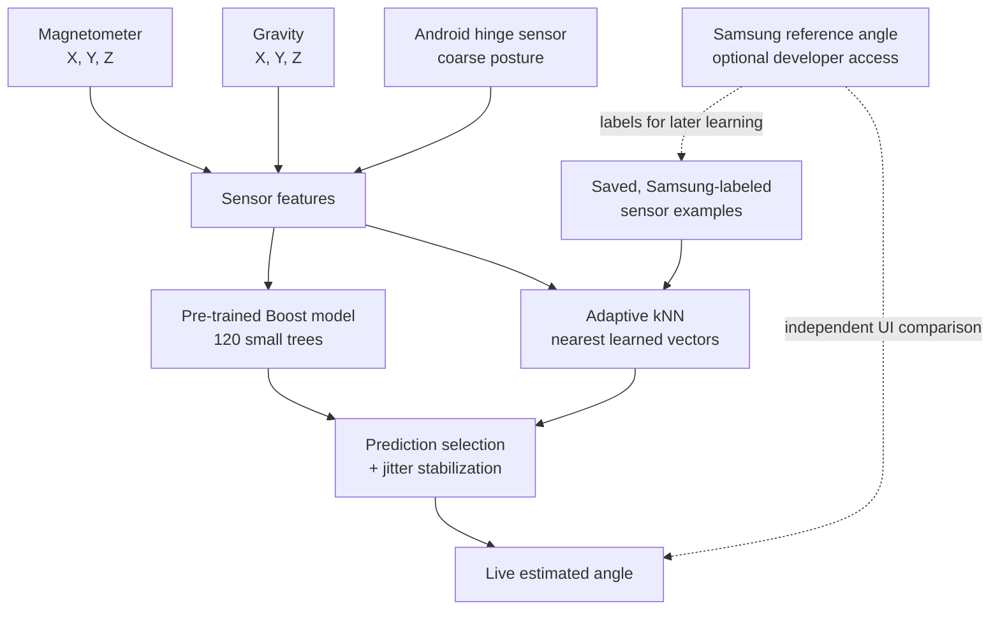

<div align="center">

# Flip7 Angle Lab

**Researching the Galaxy Z Flip7 hinge angle without ADB or privileged Android sensors.**

A small Android research app that visualizes the hinge angle, explores what
the phone's sensors can actually measure, and learns to estimate the fold
angle **without requiring ADB for everyday use**.

<p>
  
  
  
  
  
</p>

**[Research](#research-question) · [Quick start](#quick-start) · [How it works](#how-it-works) · [Results](#research-results) · [Methodology](docs/research-methodology.md) · [License](#license)**

<sub>Built and tested on Samsung Galaxy Z Flip7 · SM-F766B</sub>

</div>

---

## The idea

Foldable phones know when they're open or closed. But getting a **continuous
hinge angle in degrees** isn't always as simple as asking Android.

On the tested Galaxy Z Flip7, Android's public hinge sensor mostly exposes
coarse states (0°, 90°, 180°). Samsung also has a more precise internal angle
source, but ordinary third-party apps cannot directly register its privileged
sensor.

**Flip7 Angle Lab is an experiment in bridging that gap:** measure magnetic
field and gravity vectors, estimate the angle on-device with machine
learning, and compare the result against Samsung's reference whenever
developer access is available.

### Research question

**Can an ordinary Android app estimate the continuous 0–180° hinge angle
from publicly accessible sensors, without root, ADB or Samsung's privileged
`SSENSOR` permission?**

Our findings so far: **it can estimate the angle, but cannot guarantee
precision across arbitrary phone orientations or magnetic environments**.
This is a research prototype, not a replacement for Samsung's hardware
sensor. It keeps raw predictions, held estimates and ground-truth reference
readings distinguishable.

The offline inference path requires only the public Android magnetometer,
gravity, gyroscope and coarse hinge state. **ADB and developer permissions
are not needed to run the model**. Samsung's exact angle is optional
ground truth for collecting labels and evaluating errors, not a hidden
dependency of model inference.

See the [research methodology](docs/research-methodology.md) for
validation protocol, assumptions, failure cases and reproducibility.

### Research results

All errors are in **degrees**, not accuracy guarantees:

| Experiment | MAE | P90 absolute error |
| --- | ---: | ---: |
| Bundled Boost v2: held-out gravity-pose groups of one device's 1,500 labeled samples | **7.17°** | **16.11°** |
| Magnitude + coarse hinge, six archived leave-one-orientation-out tests | **22.88°** | **58.88°** |
| Magnitude + gravity-relative components + coarse hinge, same holdouts | **17.67°** | **45.14°** |
| XYZ/gravity-derived features + coarse hinge, same archived holdouts | **10.36°** | **28.11°** |

These experiments use different training sessions and validation
strategies; the rows are **not** interchangeable head-to-head rankings.
Cross-session magnetic shift also caused substantially larger errors.
The public repository includes **portable trained model weights**, but
does **not** publish private, device-recorded training CSVs.

### What you can do

| | Feature | What it does |
| :---: | --- | --- |
| **01** | **Live angle visualization** | An animated side-view diagram follows the fold from 0° (closed) to 180° (open). |
| **02** | **Offline ML inference** | Estimates angle using built-in model weights and standard Android sensors. |
| **03** | **Adaptive calibration** | Learns from previously labeled magnetic/gravity readings and retains examples between launches. |
| **04** | **Samsung reference comparison** | Shows the manufacturer-derived angle alongside the model when developer access is configured. |
| **05** | **Sensor laboratory** | Inspects available sensors, exposes diagnostics, and records raw readings. |
| **06** | **Training-data collection** | Guides fold/unfold cycles and exports timestamped CSV files for offline model training. |

## Quick start

### Just want to try it?

Build the APK below, or install one you already built. Open **Flip7 Angle Lab**
on a Galaxy Z Flip7. The built-in model can immediately estimate the hinge
angle using ordinary Android sensors:

> **ADB is not required to run ML predictions.** It is useful for installing
> a development APK and obtaining Samsung's reference measurements, but
> those are separate operations.

No root, cloud inference, or external model server is required for the
offline prediction path.

### Build from source

**Prerequisites:** Android SDK with platform 37.0, Java 17, Gradle 9.3.1+
and Android Debug Bridge (`adb`) if installing from your computer.
The project requires Android 13 / API 33 or newer and uses Jetpack Compose.

```bash
# From this repository's root
bash scripts/gradle-local.sh :app:testDebugUnitTest :app:assembleDebug :app:lintDebug

# Install on the correct connected device
adb devices -l
adb -s YOUR_FLIP7_ADB_SERIAL install -r app/build/outputs/apk/debug/app-debug.apk
```

Find the APK at:

```text
app/build/outputs/apk/debug/app-debug.apk
```

You can also sideload the built APK directly on the phone. The new
application ID is `com.mentoster.flip7anglelab`. It is independent from the
older internal prototype and starts with **no personal kNN examples**.
The **pre-trained Boost model is bundled with every APK**, so inference works
immediately, without importing any sensor CSVs. Estimates can still be wrong
in unfamiliar orientations; a clean install is not evidence of degree-level
accuracy.

## How it works

The key idea is to estimate a mechanical angle from signals that a regular
Android application can read.



### 1. Pre-trained model, bundled with the APK

The primary offline model is a **gradient-boosted ensemble of 120 small
regression trees**, trained on 1,500 Samsung-labeled Flip7 sensor measurements
covering different hinge angles and 33 quantized gravity-pose groups.
The serialized weights/thresholds are included as
[`flip7_hinge_boost_v2.b64`](app/src/main/assets/flip7_hinge_boost_v2.b64)
(about 49 KB Base64 / 36.4 KB compressed). The previous v1 artifact
is retained for reproducibility. This is a **trained model
artifact**, not a raw training dataset or a saved list of labeled examples.

Its 10 numerical features combine:

- Magnetic field vector: **X, Y, Z**.
- Gravity vector: **X, Y, Z**.
- Magnetic field **magnitude**.
- Magnetic-field projection **along gravity**.
- Magnetic-field magnitude **perpendicular to gravity**.
- The **coarse public Android hinge value**.

The tree interpreter is implemented directly in Kotlin: no Python, cloud
server, TensorFlow or other ML runtime is needed on the phone. The former
6 → 8 → 1 MLP and magnetic SVR remain **legacy fallbacks only** if the new
model cannot be loaded or complete input signals are not yet available.

### 2. Adaptive, device-specific corrections

The optional adaptive estimator uses **k-nearest neighbors (kNN)**:
it compares the current magnetic/gravity feature vector against stored
examples paired with Samsung reference angles, then interpolates from up to
five nearby matches.

It keeps up to **1,500 local labeled samples** in the app's private storage.
New samples are retained across angle **and** device-orientation buckets,
rather than replacing rare calibration positions with repeated readings
of one stationary pose.
Matching first considers strict pose neighbors, then a more
orientation-tolerant search if at least two nearby examples agree within
20°. This improves coverage without trusting a lone contradictory reading.

When no sufficiently similar example exists on a previously calibrated
device, the app bridges only short kNN dropouts, then returns to the
continuously running Boost model. It never silently treats the last-known
calibration value as a fresh precise measurement.
With no personally learned examples at all, the bundled Boost model is used.

**This is not online retraining of the Boost model.** It is a separate,
reference-trained correction layer. A fresh install on another phone
starts with the same **pre-trained Boost weights**, but not someone else's
device-specific kNN examples.

### 3. Stable output without hiding the raw data

The estimate passes through a median filter, a small deadband,
time-aware smoothing, and protection against brief switches between models.
Near the mechanical fully-open stop, sustained *adaptive-model evidence*
can snap the displayed estimate to 180°.

**Noise vs. physical motion:** the app no longer assumes that a change in
the ML prediction *itself* proves hinge movement. Only a coarse hinge-state
transition or the rotation guard's strong magnetic-step evidence bypasses
the smoothing for a first-event update. When the phone rests fully open,
sporadic kNN switches near the endpoint no longer alternate the stabilized
angle between ~174° and 180°; a small confirmation window applies only
to *ambiguous* movement away from the end stop. A trusted Samsung exact
event remains on-change and is displayed without additional delay, even
when the physical hinge moves tens of degrees within a few sensor frames.

**Hinge-response priority:** when the Android hinge posture changes or a
gyro-corrected magnetic step indicates a real fold, the very next sensor
reading bypasses prediction smoothing, endpoint dwell and animation. The
on-screen geometry uses no extra 90 ms tween and model state is published
at up to 60 Hz. Rotation-only readings can still be held when the available
sensors cannot confidently distinguish them from real hinge motion.

An additional **orientation-motion guard** monitors the ordinary Android
gyroscope and the changing direction of gravity. If the *whole phone* rotates
while its coarse hinge posture stays unchanged, it **holds the last accepted
hinge estimate throughout ambiguous whole-device movement**, not just for
40 ms. After the device stops in a new pose, a different ML prediction
alone is still not evidence of hinge movement; the hold continues unless
the model consistently reconverges to the accepted angle. A coarse hinge
transition or large fast *magnetic magnitude and vector change* can release
the hold immediately. **The hold is explicitly identified on-screen**:
raw live ML predictions and sensor rates continue to update. This favors
stable angle readings during pure phone rotations, at the cost of potentially
delayed updates for *slow simultaneous folding and body rotation* that
cannot be differentiated with only one accessible IMU.

The UI displays **measured magnetometer, gravity and gyro rates**, the
number and age of real Android sensor events, and the current **raw live ML
prediction** separately from the stabilized display angle. A UI heartbeat
exposes stale streams if sensor callbacks stop. The optional Samsung
SensorsHub reference is used as the main angle **while its reader is
connected**. Samsung's hinge reference is an **on-change** event stream:
its last recorded physical angle remains valid while the hinge is still,
even when the event is hours old. The app rejects this reading as soon as
the source disconnects or the Android public hinge state contradicts it;
it then uses the live ML estimate. Logcat bootstrap preserves the original
sensor timestamp, so an old reference can never masquerade as a fresh
label for model training.
When adaptive kNN has no matching pose, the app uses its bundled trained
Boost model after a brief dropout grace, rather than freezing the last
calibrated value indefinitely.

While the main activity is visible, the display is kept awake and a
foreground-only sensor watchdog checks for missing magnetometer events.
If Android suspended non-wake-up sensors during a screen-off interval, it
refreshes SensorManager registrations on resume. This **does not promise
background measurements with the inner display switched off**; Android's
power management and fold posture still apply.

Samsung may report a raw angle such as 179° at the physical open stop.
The main display can normalize its **177–179° endpoint values** to 180°
when the Android hinge state agrees; the raw Samsung reading is still
shown separately and **never rewritten in training CSVs**.

If Samsung reports an isolated **176° while the phone is being rotated**
after the screen was already normalized to fully open, the UI also keeps
180° for that one-degree vendor fluctuation. A real change to 175° or
less, or the same 176° while not rotating, is displayed immediately.
This narrow presentation hysteresis does not change the underlying
Samsung measurement, calibration file or prediction model.

The coarse Android state alone is **not** enough to infer a precise 180°:
on this device, that state can also occur at actual angles around 150–165°.

## Does it work without ADB?

| Mode | After a normal APK install | ADB / developer access |
| --- | :---: | --- |
| Live fold visualization | Yes | Not needed |
| Offline pre-trained Boost estimate | Yes | Not needed |
| Use previously saved adaptive samples | Yes | Not needed |
| Collect ordinary Android sensor data | Yes | Not needed |
| Read Samsung's privileged reference angle | Usually no | Usually required |
| Add **new** Samsung-labeled adaptive samples | Only with an accessible reference | Usually required |
| Guided supervised calibration | Requires reference | Usually required |

For most users, the offline ML path is the starting point. Developer access
is primarily useful for **benchmarking, collecting labels, and improving
future models**.

## Accuracy and limitations

### Debugging false hinge motion and sensor stalls

Debug APKs include a **detailed, local Logcat decision trace**. This makes
it possible to identify a false fold-angle change during whole-phone rotation
without dumping unrelated Android system logs:

```bash
adb devices -l
adb -s YOUR_FLIP7_ADB_SERIAL logcat -v threadtime \
  -s 'Flip7AngleTrace:D' 'Flip7AngleLab:I' 'Flip7AngleLab:W' 'AndroidRuntime:E' '*:S'
```

`Flip7AngleTrace` logs a frame whenever hinge/rotation state changes,
approximately **8 frames/s while moving**, and **1 frame/s while still**.
The trace includes sensor-event timestamps, raw magnetic/gravity/gyro XYZ,
magnetic magnitude and per-event changes, magnetic projection along gravity,
coarse Android hinge state, Samsung reference and its age, sensor freshness,
Boost and kNN predictions, their disagreement, decision reason, the guarded
angle, the stabilized angle, and the **actual displayed source and value**.
The lightweight `Flip7AngleLab` summary is retained at 1 Hz.

To reproduce a problem, keep the screen on, observe the hinge without
moving it, **rotate the entire phone without folding**, then perform a
separate genuine fold/unfold. Look for these decision reasons:
`rotation-hold-start`, `rotation-hold-motion`,
`rotation-hold-unverified`, `magnetic-step-fold`,
`hinge-transition` and `tracking`. A `magnetic-step-fold` during a
known fixed-hinge rotation reveals a false-positive folding heuristic.
Samsung's precise reference is **on-change**: its last value remains
eligible while its source is connected, even if older than 350 ms.
The debug trace's `display` field is calculated **before** the UI-only
near-180° presentation hysteresis. Neither a coarse posture nor a
heuristic reason proves a precise mechanical angle.

Detailed raw-sensor tracing is **disabled in non-debuggable release builds**.
Sensor traces may describe device movement; review and redact them before
sharing, and never publish pairing credentials or full unfiltered Logcat.

> [!IMPORTANT]
> **Experimental software, not a precision instrument.** Smooth output,
> or a 180° display at the end stop, is not proof of degree-level accuracy
> everywhere else in the fold range.

Holding the last calibrated angle prevents false jumps when the whole
phone is rotated into an unfamiliar orientation, but it **does not measure
new hinge movements** in that unrecognized pose until similar labeled
sensor examples become available. An accurate, orientation-independent
predictor for arbitrary future phones still requires more diverse training
data and independent validation.

The original MLP was trained on a September 2026 Z Flip7 capture. In real
tests it has sometimes predicted **about 130° when Samsung reported 179°**;
older post-processing could make that appear as 145°. New firmware, different
orientations, magnetic interference and unfamiliar motion patterns can all
affect predictions.

The updated Boost v2 model was checked using **three gravity-pose-group
holdouts** on the test device's latest 1,500 labeled examples: combined
**MAE 7.17°** and **P90 16.11°** across 1,414 held-out predictions.
The worst individual errors exceeded 50°. A previously unrepresented
fully-open phone pose that v1 misread as ~156° was retrained to predict
~177.2° with v2. This is a same-device fit, **not** independent validation
on a new recording or proof of Samsung-equivalent accuracy. The private
Samsung source remains more reliable when available.

An older full calibration recording covers six named orientations with
0°–180° folds, but tests holding out entire orientations showed that
magnetic and gravity features still change substantially with phone pose.
That is why pose-motion gating is necessary; **model smoothing alone is
not enough to guarantee orientation independence**. The second-half
accelerometer exists but requires Samsung's privileged `SSENSOR` permission
on the tested phone.

The adaptive estimator can perform much better **in already observed
sensor conditions**, but it learns from recent Samsung labels. Therefore
a low error shown during the same session is **not independent validation**.
To evaluate real generalization, keep entire movements/orientations or
recording sessions out of training and measure errors on those unseen captures.

Current scope: **Samsung Galaxy Z Flip7 (SM-F766B)**. Other Flip/Fold models
have not been validated, and sensor configurations may differ.

## Calibration and data collection

To collect reliable supervised labels, enable an available Samsung
reference-angle source. On the tested firmware this can be done with
`READ_LOGS`, using a development computer:

```bash
adb -s YOUR_FLIP7_ADB_SERIAL shell pm grant --user 0 \
  com.mentoster.flip7anglelab android.permission.READ_LOGS
```

Android may additionally show a **one-time permission prompt** to let
Flip7 Angle Lab read device logs. Log access can expose sensitive system
information; grant it only on a device you trust and understand. The app
filters the Samsung SensorsHub folding-angle feed. If no new event arrives
while the hinge is stationary, a previously paired local Wireless ADB
transport can act as another reference source.

Once the UI shows a live Samsung reference:

1. Tap **Start calibration**.
2. Follow the guide through **6 orientations × 3 speeds × 4 cycles**, then
   static holds at **10° intervals**.
3. Let the app save the `*-sensors.csv` and `*-exact.csv` recordings, or use
   **Record raw dataset** for unguided measurements.

Exports appear in `Downloads/Flip7AngleLab`. Raw recordings without
reference labels remain useful for diagnostics but are not supervised
angle-training examples.

## Retrain the bundled model

The trainable portable Boost model uses the app's private, eight-column
adaptive calibration cache (magnetic XYZ, gravity XYZ, public hinge, Samsung
raw reference). A development phone with previously learned labels can
stream the cache directly into the training script:

```bash
adb -s YOUR_FLIP7_ADB_SERIAL exec-out run-as com.mentoster.flip7anglelab \
  cat files/flip7-angle-calibration-v1.csv | \
  uv run --with numpy --with scikit-learn \
    python scripts/train-release-angle-model.py --validate --emit
```

The script performs grouped gravity-pose validation, trains the model and
checks the serialized tree predictions against scikit-learn. The Base64
between `MODEL_BASE64_START` and `MODEL_BASE64_END` is the *model*,
not the underlying sensor rows; it can replace the bundled
`app/src/main/assets/flip7_hinge_boost_v2.b64` after review and versioning.
No raw data needs to be included in the public Git repository or GitHub
Releases. The tiny model asset itself is tracked in Git and can optionally
be attached to a GitHub Release for standalone consumption.

### Legacy MLP experiments

Reference captures are **not included in the public repository**: the
original data exceeds 800 MB and may contain device telemetry. Record your
own labeled capture (see above) and place the sensor and exact CSV files
under the local `captures/` directory. With Python,
[uv](https://docs.astral.sh/uv/) and the dependencies below:

```bash
uv run --with numpy --with pandas --with scipy --with scikit-learn \
  python scripts/train-calibration-v2-mlp.py \
  captures/YOUR_CAPTURE-sensors.csv \
  --exact-csv captures/YOUR_CAPTURE-exact.csv \
  --validate
```

The script aligns sensor and Samsung-reference timestamps, trains the MLP,
runs leave-one-orientation-out checks when `--validate` is supplied, and
prints Kotlin weights. **It does not automatically replace the model in
the APK.** Updated weights must be reviewed and integrated separately.

New and historical CSV recordings are processed using public
`Sensor.type` identifiers. On modern Android, the deprecated diagnostic
`sensor_handle` field is left at `-1` rather than using restricted
private API reflection.

## Project structure

```text
app/src/main/java/com/mentoster/flip7anglelab/
├── MainActivity.kt
├── ui/
│   └── AngleLabScreen.kt           # Compose UI + hinge visualization
└── fold/
    ├── DirectSensorLab.kt          # Android sensors + CSV recording
    ├── MagneticHingeEstimator.kt   # Boost first; legacy MLP / SVR fallback
    ├── Flip7HingeBoostModel.kt     # Portable trained-tree interpreter
    ├── AdaptiveAngleCalibration.kt # Persistent kNN corrections
    ├── AngleEstimateStabilizer.kt  # Motion-aware anti-jitter filter
    ├── OrientationMotionGuard.kt   # Hold output during whole-phone rotations
    ├── AngleDisplayEndpoint.kt     # Display-only endpoint handling
    ├── CalibrationV2Guide.kt       # Guided capture workflow
    ├── SamsungLogcatAngleReader.kt # Samsung SensorsHub log parser
    ├── SamsungAdbAngleRuntime.kt   # Reference source selection
    └── FlipRefAngleBridge.kt       # Factory reference via shell
captures/                            # Private local recordings (Git ignored)
app/src/main/assets/                  # Published pre-trained model artifact
scripts/                             # Build, diagnostics, training, QA
```

## Roadmap

- [x] Bundle a standalone trained offline model, independent of ADB and calibration CSVs.
- [ ] Train and validate on more devices, firmware versions and entire unseen sessions.
- [ ] Benchmark on **held-out** complete fold/unfold sequences.
- [ ] Improve robustness to external magnets, rotation and sensor drift.
- [ ] Validate rotation guarding against real fixed-hinge, multi-axis motion
      and simultaneous fold-plus-rotation sequences.
- [ ] Compare alternative lightweight models for reliable no-ADB inference.
- [ ] Add representative on-device screenshots and reproducible benchmark results.

## Contributing

Contributions, reproducible bug reports and new-model experiments are
welcome. Read [CONTRIBUTING.md](CONTRIBUTING.md) first, especially before
sharing any device logs or calibration data.

Security concerns and sensitive log reports should follow the guidance
in [SECURITY.md](SECURITY.md).

## License

Flip7 Angle Lab's original source code is released under the
**[MIT License](LICENSE)**, Copyright (c) 2026 mentoster.

Third-party components retain their own licenses and attribution; they are
**not relicensed** by this project's MIT license. See
[THIRD_PARTY_NOTICES.md](THIRD_PARTY_NOTICES.md).

## Notes and acknowledgements

This is an independent research/development project, not an official Samsung
application. Samsung and Galaxy are trademarks of their respective owners.

The local ADB pairing approach builds on
[`nnnnnnn0090/Z-Fold-Duo-TEST`](https://github.com/nnnnnnn0090/Z-Fold-Duo-TEST).
Local pairing and mDNS discovery use
[`flyfishxu/kadb`](https://github.com/flyfishxu/kadb).
See [THIRD_PARTY_NOTICES.md](THIRD_PARTY_NOTICES.md) for the applicable
third-party licenses and acknowledgements.

---

<div align="center">

**A fold angle is more than an open/closed state.**

*Measure it. Learn from it. Make the offline model better.*

</div>
