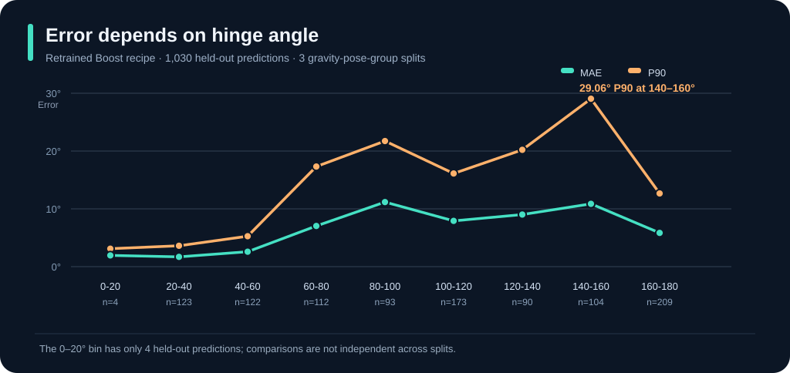
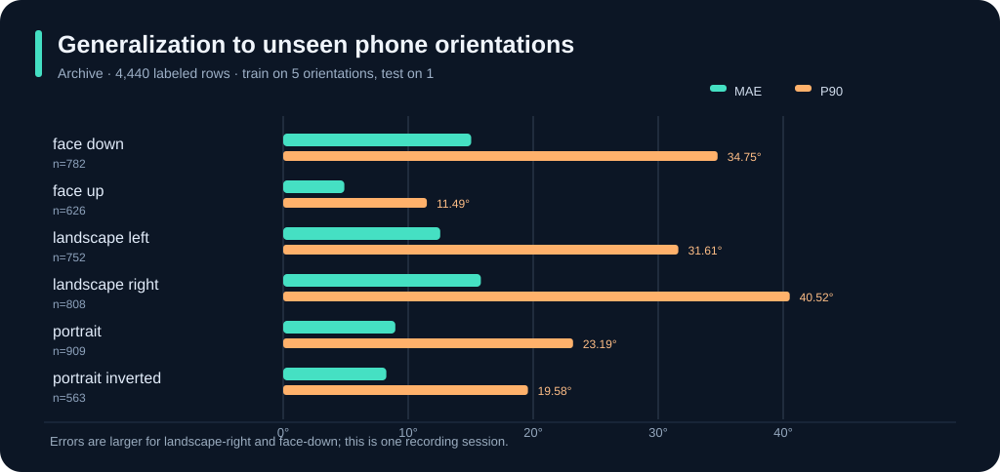
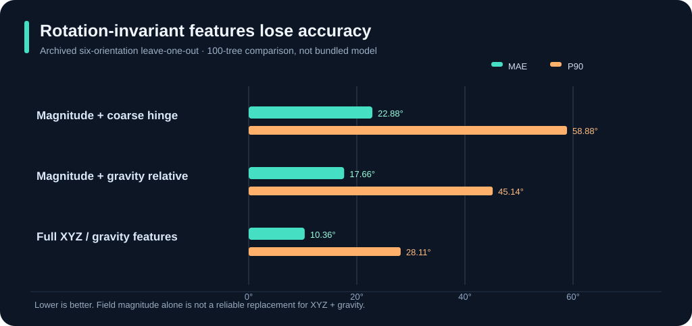
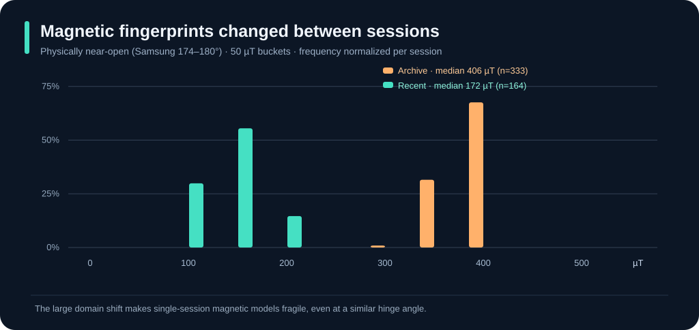
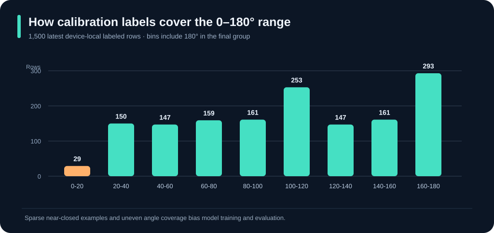

# Research methodology — measuring hinge angle without ADB

## Question and hypothesis

Can an unprivileged Android application estimate the physical 0–180°
hinge angle of a Samsung Galaxy Z Flip7 (SM-F766B), **without** ADB, root,
private APIs, or Samsung's privileged sensors?

**Hypothesis:** changes in a phone's publicly accessible magnetometer,
gravity and coarse Android hinge state contain information about mechanical
hinge movement. The observation is not unique: turning the *entire* phone
changes many of those readings too. Our research evaluates both predictive
accuracy and the cost of avoiding false hinge motion.

Two deliberately separate paths are implemented:

1. **Ordinary no-ADB operation:** Android magnetometer, gravity and gyro,
   with the public coarse hinge sensor, feed an embedded Boost model.
   An optional device-local kNN corrects the estimate using previously
   acquired labels. Temporal stabilization and a rotation guard distinguish
   the last **held estimate** from a new model reading. No computer,
   external service or READ_LOGS permission is required for this path.
2. **Reference-assisted development:** Samsung's precise angle may be
   accessed through an authorized SensorsHub diagnostic stream or
   developer ADB. This provides labeled ground truth and a separate
   comparison display. It is **not** an input to the ordinary Boost model.

The tested firmware exposes public coarse hinge states near 0°, 90° and
180°. Its precise proprietary Folding Angle sensor and second-half
accelerometer require privileged `SSENSOR` permissions. They cannot
be assumed available to ordinary applications. In particular, a
reported public 180° does **not** prove a precise 180° physical angle.

## Feature sets and model

The deployed Boost v2 ensemble contains 120 small regression trees,
evaluated directly by the Android Kotlin interpreter. Its 10 inputs:

- magnetic field X, Y, Z from the standard Android magnetometer;
- gravity X, Y, Z;
- magnetic field magnitude;
- projection of the magnetic field along gravity;
- magnitude of the magnetic component perpendicular to gravity;
- coarse public Android hinge value.

The separately trained k-nearest-neighbor correction layer can retain
up to 1,500 Samsung-labeled sensor samples in app-private storage. It is
not an additional universal pretrained model.

During a detected whole-device rotation, the app can **hold** its last
accepted hinge angle instead of displaying a pose-contaminated prediction.
This avoids certain false movements but also creates a measurable
coverage/latency cost: slow simultaneous turning and folding can be
ambiguous. **A held result is not a new physical measurement.**

## Data and evaluation

### Published charts and aggregated data

Five native SVG figures and a machine-readable
[aggregate JSON snapshot](data/aggregate-metrics-2026-11-20.json)
are part of the repository. All the visualized values are aggregated;
the original training rows and identifiable device logs are not
redistributed.











Two internal datasets were used during development; the raw data is
private and is **not** included in GitHub:

| Dataset | Rows | Description |
| --- | ---: | --- |
| Recent device-local calibration cache | 1,500 | Samsung-reference-labeled magnetic XYZ, gravity XYZ, coarse hinge, exact reference |
| Earlier multi-orientation sensor capture | 4,440 | Labeled readings in six named orientations: portrait, inverted portrait, both landscapes, face-up, face-down |

### Bundled Boost v2

An earlier v2 training snapshot used three gravity-pose-group holdouts.
Combined results across **1,414 validation predictions** were
**MAE 7.17° and P90 16.11°**, with individual errors over 50°.

The **updated snapshot used for the figures** includes 1,500 rows in
43 quantized gravity-pose groups. Repeating the same training recipe
(not re-evaluating the already bundled model weights) produced:

| Split | Test predictions | MAE | P90 | Maximum error |
| --- | ---: | ---: | ---: | ---: |
| Gravity-group split 1 | 307 | 7.58° | 17.11° | 37.00° |
| Gravity-group split 2 | 307 | 5.61° | 13.04° | 38.72° |
| Gravity-group split 3 | 416 | 6.83° | 17.19° | 35.79° |
| **Combined** | **1,030** | **6.69°** | **15.89°** | **38.72°** |

Absolute-error percentiles were **P50 4.26°**, **P75 8.91°**,
**P90 15.89°**, **P95 21.70°**, **P99 32.77°**. The same example
may appear in multiple random test splits, so 1,030 is the number
of tested predictions, not necessarily unique independent samples.
All results remain single-device, within-session evaluations.

| Samsung reference range | Cache labels | Tested predictions | MAE | P90 |
| --- | ---: | ---: | ---: | ---: |
| 0–20° | 29 | 4 | 1.95° | 3.11° |
| 20–40° | 150 | 123 | 1.69° | 3.61° |
| 40–60° | 147 | 122 | 2.59° | 5.27° |
| 60–80° | 159 | 112 | 7.04° | 17.32° |
| 80–100° | 161 | 93 | 11.17° | 21.74° |
| 100–120° | 253 | 173 | 7.92° | 16.12° |
| 120–140° | 147 | 90 | 9.02° | 20.21° |
| 140–160° | 161 | 104 | 10.87° | 29.06° |
| 160–180° (including 180°) | 293 | 209 | 5.84° | 12.67° |

The 0–20° group has only four held-out predictions; its apparent
low error must **not** be generalized.

The JSON and figures freeze **one dated aggregate snapshot**. The
private 1,500-row adaptive cache is updated as new trusted labels
become available, so rerunning the benchmark later can give slightly
different numbers. One subsequent live replay gave MAE 6.63° and
P90 15.81° instead of the frozen 6.69° / 15.89°. Neither estimate
is a cross-device, independent recording-session result.

### Rotation-related feature experiments

An experimental 100-tree `HistGradientBoostingRegressor`, with maximum
12 leaves, learning rate 0.07 and L2 regularization 3, evaluated
feature alternatives on the earlier 4,440-row capture. Each physical
orientation was held out in turn:

| Feature family | MAE | P90 |
| --- | ---: | ---: |
| Magnetic magnitude, coarse hinge | 22.88° | 58.88° |
| Magnetic magnitude, gravity projection and perpendicular magnitude, coarse hinge | 17.67° | 45.14° |
| Original XYZ/gravity-derived inputs and coarse hinge | 10.36° | 28.11° |

These numbers describe a **feature experiment**, not a comparison of
separately deployed APK versions. Rotation-invariant magnitude alone
performed considerably worse than the full pose-sensitive inputs.

As a separate experiment, the 120-tree v2 training recipe was also
evaluated on the archive by withholding each named orientation:

| Excluded orientation | Predictions | MAE | P90 |
| --- | ---: | ---: | ---: |
| Face-down | 782 | 15.04° | 34.75° |
| Face-up | 626 | 4.89° | 11.49° |
| Landscape-left | 752 | 12.56° | 31.61° |
| Landscape-right | 808 | 15.81° | 40.52° |
| Portrait | 909 | 8.97° | 23.19° |
| Inverted portrait | 563 | 8.25° | 19.58° |

Cross-session domain shift was also substantial: when magnitude-only
models were trained on the archived recording and evaluated on the
newer cache, MAE was **37.03°**; in the opposite direction it was
**40.31°**. At Samsung reference angles between 174° and 180°,
the archived magnitude distribution had a **median 406.31 µT**
(P05 352.70 / P95 441.53 µT, n=333); the new cache had
**median 172.00 µT** (P05 141.31 / P95 212.12 µT, n=164).
These are very different magnetic domains even near the same physical
hinge angle. A generic normalization or static offset does not
reliably resolve the shift.

## Reproduce from your own data

The **unit tests, static checks and APK build** need no attached phone:

```bash
bash scripts/gradle-local.sh :app:testDebugUnitTest :app:assembleDebug :app:lintDebug
```

They check source parsing, model serialization, rotation guards and
output stability, not independent physics. For supervised validation
and retraining, collect your **own consented reference labels**;
the archived private captures cannot be reconstructed from the model
weights. When an eight-column calibration cache is available:

```bash
uv run --with numpy --with scikit-learn \
  python scripts/train-release-angle-model.py --validate --emit \
  < your-own-calibration.csv
```

The legacy MLP research can also be reproduced using newly collected
sensor and reference CSVs with
`scripts/train-calibration-v2-mlp.py`. Neither script uploads sensor
data by itself.

To reproduce **aggregate statistics and the numbers behind the charts**
from a consented local eight-column cache, without writing raw data:

```bash
uv run --with numpy --with scikit-learn \
  python scripts/research-benchmarks.py < your-own-calibration.csv
```

For the six-orientation comparison, also pass a reference recording
matching the legacy capture schema:

```bash
uv run --with numpy --with scikit-learn \
  python scripts/research-benchmarks.py \
  --archive-sensors captures/your-own-sensors.csv \
  < your-own-calibration.csv
```

This prints aggregate JSON only. The publicly tracked
`docs/data/aggregate-metrics-2026-11-20.json` is a reference
snapshot to compare to, **not a substitute for the original private
records**.

For stronger independent validation, keep **entire sessions, complete
fold/unfold cycles and individual devices** out of training.
Report MAE, P90, maximum absolute error, response latency, and the
percentage of time a value is explicitly **held or uncertain**.
Separately measure the performance of the raw model and displayed
angle, because post-processing can disguise model errors.

## Suggested falsification tests

1. Hold the physical hinge fixed at about 90°, 155° and 177°.
   Rotate the entire phone in yaw, pitch and roll. Compare the raw
   model, displayed angle and independently measured Samsung label.
2. Keep the body orientation fixed. Slowly fold and unfold across
   transitions of the coarse public Android hinge state.
3. Fold the hinge **while rotating the entire phone**. This is the
   difficult non-identifiable case for a single-half motion sensor.
4. Repeat in different locations and near different magnetic
   environments. Watch for domain shift and falsely stable held values.

The core unresolved issue is **observability**: the accessible signals
do not always uniquely encode a hinge angle under unconstrained
orientation and environmental magnetic interference. This project
does not claim to remove that physical limitation.

## Data privacy and licensing

Training captures can encode movement, timestamps and device metadata.
They are excluded from version control. The portable trained model
artifact is published; raw samples and pairing credentials are not.
Developer-only `READ_LOGS` access can expose sensitive phone logs and
must never be silently enabled for a user.

This is independent, experimental research, not a Samsung product
or a certified angle-measuring instrument.
